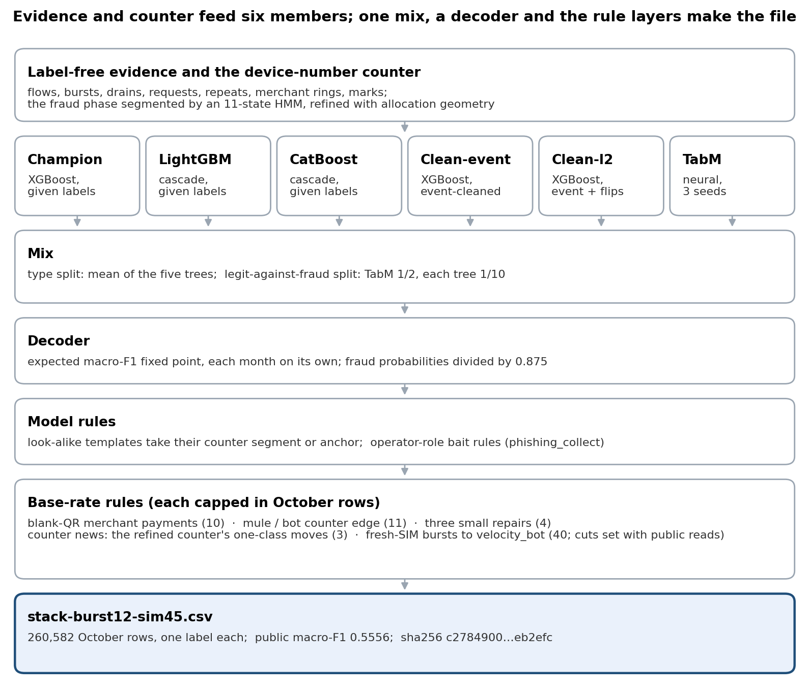
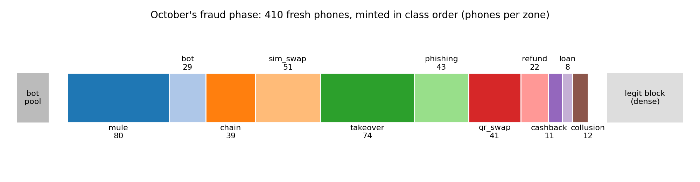
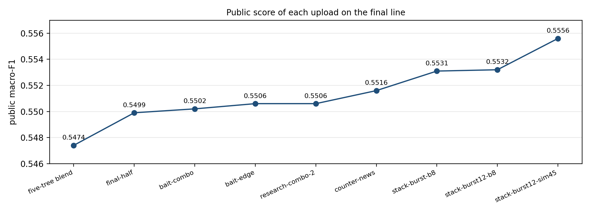

# UPI Fraud Rings: GradientAscent Solution

**Team Name:** GradientAscent  
**Team Member:** Ameya Borkar  
**Submission Date:** 15 November 2026

### Contents

- [1. Executive Summary](#1-executive-summary)
- [2. Methodology](#2-methodology)
- [3. Label-free Evidence and the Device Counter](#3-label-free-evidence-and-the-device-counter)
- [4. Models, Decoding and Rules](#4-models-decoding-and-rules)
- [5. Results & Error Analysis](#5-results--error-analysis)
- [6. Conclusion](#6-conclusion)
- [Appendix A. Code Artefacts](#a-code-artefacts)
- [Appendix B. Additional Results](#b-additional-results)

---

## 1. Executive Summary

Our best upload, `stack-burst12-sim45`, scores **0.5556 macro-F1 on the public leaderboard**, across
12 classes (legit plus 11 fraud types) on 260,582 October payments. It rebuilds **byte for byte** from
the code in this archive with one command (sha256 `c2784900…eb2efc`).

The pipeline has three parts.
- **Label-free evidence.** It rebuilds the generator's fraud routines from how rows connect, with
  no labels: accounts, phones, receivers and time.
- **Members.** Five boosted cascades and a TabM network score every row.
- **Decision.** An expected-macro-F1 decoder and a small set of capped rules set the final call.

The key insight is the **device-number counter**. Fresh phones are numbered in creation order, and
the fraud routines write their phones class by class. So the October block of fresh phone numbers
certifies fraud rows that look ordinary, and gives their type.

Every change was judged before upload in three ways:
- on whole held-out months, with given, cleaned and generator-only labels and an event bootstrap;
- on September frames thinned to October's density, with the counter rebuilt as October's is;
- on the counter's labelled passes.

The last two steps of the best file were settled differently: the cuts of a burst rule and the
removal of one border row came from public leaderboard reads. We state this plainly in Sections 4
and 6.



**Figure 1.** The pipeline: label-free evidence and the device counter feed six member models; one
mix, a per-month decoder and the rule layers set the calls.

---

## 2. Methodology

### 2.1 Problem Analysis

**The task.** Each October 2026 UPI payment gets one of 12 classes:
- `legit`;
- `mule_account`, `velocity_bot`, `layering_chain`;
- `sim_swap`, `account_takeover`;
- `phishing_collect`, `qr_swap`, `refund_abuse`, `fake_cashback`, `loan_app_extortion`;
- `merchant_collusion`.

Macro-F1 weighs every class the same, so the small fraud classes matter as much as the large ones.

**The data.**
- Train: July to September, 1,564,060 rows.
- Test: October, 260,582 rows.
- Two side tables: accounts and merchants.
- An all-legit upload scored 0.0816, which reads the test fraud share as 4.06 %.

**Three twists shaped the work.**
- **Noisy training labels, clean test labels.** About 12 % of train fraud is unreported (labelled
  legit), while the test labels are clean. A model trained on the given labels therefore
  under-calls fraud.
- **Ordinary-looking fraud.** About 62 % of fraud labels sit on rows that look exactly like
  ordinary payments, with no link to other fraud. No feature, link or pattern separated them in
  any of our searches (held-out AUC about 0.50). The reachable fraud is the rest.
- **October is different.** It is half as dense, and its class mix moves: fewer bot phones, more
  mule bursts, larger merchant rings, festival amounts. A model's train-month habits must transfer.

### 2.2 Solution Strategy

**Approach Type:** Hybrid.
- Label-free evidence rebuilds every reachable fraud event.
- Boosted cascades and a neural tabular model score the rows.
- A decoder maximises expected macro-F1 directly.
- A few counter-backed rules set the remaining calls.

**Two principles run through the design.**
- **Find every reachable fraud row and type it right, and leave the rest alone.** Calls on
  ordinary-looking rows cost precision without gaining recall.
- **Measure before adopting.** Every change must be non-negative in each held-out month, with a
  bootstrap lower bound above zero, and hold on October-like frames. A tie goes to the simpler
  file.

**Core Innovation:** three ideas carried most of the gain.

**The device-number counter.** New phones above 420,000 are minted in order. Each split has three
blocks:
- a reserved bot pool;
- a **fraud phase**, about 41 % of its numbers used, written class by class;
- a dense legit block.

An 11-state left-to-right HMM over label-free anchors segments the fraud phase, so a phone's
position gives its type. A refined version also reads each phone's allocation geometry: the run of
unused numbers below it, and its row count.

**Correcting for unreported fraud.** The decoder divides fraud probabilities by 0.875. Two members
train on event-cleaned labels: label-free events that are fraud in most rows lend their label to
their legit-labelled rows.

**Expected-macro-F1 decoding.** A fixed point sets each class's threshold to maximise expected
macro-F1 given the probabilities. Each month is decoded on its own, October included, so October's
own mix sets its thresholds.

---

## 3. Label-free Evidence and the Device Counter

### 3.1 Evidence families

Each family is computed inside one split, with no labels. October's rows are used through code
only, to connect them to each other.

**Table 1.** The label-free evidence families.

| Family | Finds | How |
|---|---|---|
| flows | layering chains, mule fan-ins | P2P hops passed on within 6 h; bursts of 8 or more senders paying small whole amounts, then onward transfers |
| bursts | velocity bots | sessions of 10 or more rows on a shared device |
| drains | sim_swap, account_takeover | balances stepping down by exactly 0.25x (sim_swap) or 0.35x (takeover) |
| requests | phishing_collect | just-under-limit collect requests and cashback baits |
| repeats | refund_abuse, loan_app_extortion | repeat refund chains and evening lending chains |
| merchant | merchant_collusion, refund_abuse | round-amount merchant rings, typed by size |
| marks | several | single-row generator marks (e.g. a blank QR check) |

### 3.2 The device-number counter

**Table 2.** The counter's blocks in train and October (aggregates).

| Block | Train phones | Train occupancy | October phones | October occupancy |
|---|---|---|---|---|
| bot pool | 81 | 0.028 | 7 | 0.003 |
| fraud phase | 2,240 | 0.411 | 410 | 0.447 |
| legit block | 45,177 | 1.000 | 7,462 | 1.000 |

**Evidence that the class order holds:**
- 94.3 % of train fraud-phase phones carry a fraud-majority cleaned label.
- A monotone fit in the class order disagrees with only 2.4 % of fraud phones.
- The label-free HMM agrees with the monotone label fit on 98.9 % of train fraud phones.
- On four labelled passes at October's size, the refined counter cut the boundary error from 82
  phones to 58.



**Figure 2.** October's fraud phase on the device-number line: 410 fresh phones in class order,
between the bot pool and the dense legit block.

---

## 4. Models, Decoding and Rules

### 4.1 Members

Every member uses the same ~230 label-free features: relational windows, the evidence columns and
the counter columns. Each is fitted per month fold with three seeds.

**Table 3.** The six members.

| Member | Model | Training labels |
|---|---|---|
| champion | XGBoost cascade: P(fraud) x P(type given fraud) | given |
| lgbm | LightGBM cascade | given |
| catboost | CatBoost cascade | given |
| clean-event | XGBoost cascade | event-cleaned |
| clean-l2 | XGBoost cascade | event-cleaned, plus noise-floor flips |
| tabm | TabM neural ensemble | given |

### 4.2 Mix and decoder

The two halves of the mix are set separately:
- **The type split** is the mean of the five trees.
- **The legit-against-fraud split** is half TabM and a tenth from each tree.

TabM never votes on the type, because that lost on public (0.5483 against 0.5499).

The decoder is the expected-macro-F1 fixed point, run per month with fraud scale 0.875.

### 4.3 Rules

**Rules that run after the decoder:**
- **Look-alike templates:** an event's class comes from its counter segment or anchor.
- **Operator-role bait rules:** lone ₹10 baits by, and first payments to, accounts that act as
  operators in other months become phishing_collect.

**Base-rate rules** come last. Each carries a cap on the October rows it may change.

**Table 4.** The base-rate rules in the best file.

| Rule | What it does | October rows |
|---|---|---|
| `blank_merchant_qr` | a QR payment to a merchant with a blank QR check takes its likeliest fraud type | 10 |
| `mule_edge` | bot-called rows in October's (wider) mule zone become mule_account | 11 |
| `far_segment`, `legit_topup`, `just_under_pay` | three small order and bait repairs | 4 |
| `counter_news` | the refined counter moves a row one class when its call followed the old segment, with posterior at least 0.7 | 3 |
| `fresh_bursts` | a mule-shaped burst with no fraud-phase phone, 12 rows or more, youngest sender SIM 45–50 h old, becomes velocity_bot | 40 |

**How the last rule was set.** `fresh_bursts` is only weakly supported in train: of 9 large,
young-SIM bursts without a fraud-phase phone, 4 are velocity_bot. Its cuts (12 rows, SIM 45–50 h)
were chosen with public leaderboard reads, one October event at a time. The removal of one border
row from the previous best file was decided the same way.

---

## 5. Results & Error Analysis

### 5.1 The upload path



**Figure 3.** The public score of each upload on the final line.

**Table 5.** The uploads that built the final line.

| File | What changed | Public |
|---|---|---|
| `final-half` + blank-QR rule | TabM sets half of the legit-against-fraud split | 0.5499 |
| `bait-combo` | operator-role bait rules, 7 rows | 0.5502 |
| `bait-edge` | the counter's mule / bot edge, 10 rows | 0.5506 |
| `research-combo-2` | three small base-rate rules, 4 rows | 0.5506 |
| `counter-news` | the refined counter in the rules, 4 rows | 0.5516 |
| `stack-burst-b8` | one 28-row burst to velocity_bot, 1 border row | 0.5531 |
| `stack-burst12-b8` | two more bursts | 0.5532 |
| **`stack-burst12-sim45`** | one of those bursts back, the border row removed | **0.5556** |

### 5.2 Validation of the counter step

`counter-news` is the last step validated entirely offline.

**Table 6.** `counter-news` against the file before it (`research-combo-2`).

| Test | given | cleaned |
|---|---|---|
| month folds, Jul / Aug / Sep | +0.00004 / +0.00008 / +0.00088 (bound +0.00004) | +0.00003 / +0.00008 / +0.00104 (bound +0.00004) |
| four October-like frames, pooled | +0.00157 [+0.00071, +0.00264] | +0.00175 [+0.00082, +0.00289] |

On the frames, its sim_swap → account_takeover moves were right on **32 of 32** rows (cleaned
labels).

### 5.3 Error analysis

**Where the loss sits.** The members agree with each other closely: leave-one-month-out macro-F1 is
0.5120 to 0.5123 on given labels and about 0.9010 on generator-only labels. The gap between those
two numbers is the ordinary-looking fraud, which carries no signal.
- Nine independent searches each returned held-out AUC about 0.50, covering:
  - row features and history;
  - entity links and two-hop graph links;
  - identifiers, file order and the side tables;
  - a fine-tuned language model on look-alike pairs.
- The file order is chunked, not shuffled throughout, but chunk membership carries no label
  information.

**What did not transfer.**
- Members retrained on a counter at October's density: positive on the frames, but negative in
  one month, and 0.5497 on public.
- A takeover flip inside the own-phone drain: 0.5494.
- Self-training on October's own confident events: fraud-only pseudo-labels lost 0.006 on the month
  folds; with the fraud share held fixed, a tie.

---

## 6. Conclusion

GradientAscent's solution finds the reachable fraud and leaves the rest alone. The approach has
three parts:
- label-free evidence rebuilds each fraud routine;
- a device-number counter certifies and types the fraud phase;
- boosted cascades and TabM, decoded for expected macro-F1, set the calls.

Every step up to `counter-news` (public 0.5516) was validated offline before upload. The steps after
it, worth +0.0040 on public, were settled with public reads of single October events, and we
state that openly. The archive rebuilds the best file byte for byte. A from-scratch rebuild of the
six members, from an empty cache on one RTX 5060 Ti, took 5,086 s and was byte-identical.

---

## Appendix

### A. Code Artefacts

**Table 7.** What the archive holds.

| Path | Contents |
|---|---|
| `src/ringtrace/` | the pipeline package: ledger, evidence families, device counter, members, decoder, rules, final build |
| `recipes/stack/stack-burst12-sim45.json` | the best upload: members, mix, decoder and rules |
| `recipes/*.json` | the six member recipes |
| `scripts/build_final.sh` | one command: features, members, final file |
| `tests/` | unit tests on synthetic data |

**Rebuild command:**

```
RINGTRACE_THREADS=8 bash scripts/build_final.sh recipes/stack/stack-burst12-sim45.json <out>
sha256sum <out>/stack-burst12-sim45.csv   # c278490094706e156dc4f4d573989fafda24de896f3a7ec147fb5fc886eb2efc
```

### B. Additional Results

**Table 8.** Leave-one-month-out macro-F1 per member (mean of July, August and September), after
the decoder and the template rule.

| Member | given | cleaned | generator-only |
|---|---|---|---|
| champion | 0.5122 | 0.5665 | 0.9010 |
| lgbm | 0.5122 | 0.5667 | 0.9011 |
| catboost | 0.5120 | 0.5662 | 0.9008 |
| clean-event | 0.5123 | 0.5666 | 0.9012 |
| clean-l2 | 0.5122 | 0.5666 | 0.9012 |
| five-tree blend | 0.5123 | 0.5667 | 0.9013 |

**Table 9.** October call ratios against the train months, from the drift scan (aggregates).

| Class | October / train | Traced to |
|---|---|---|
| velocity_bot | 0.52 | fewer bot phones in October |
| mule_account | 1.24 | more mule bursts; the counter's mule zone is 1.21x wider |
| layering_chain | 0.89 | hops within the law, as in train |
| merchant_collusion | 0.63 | ring sizes moved; no mid-size rings in October |
